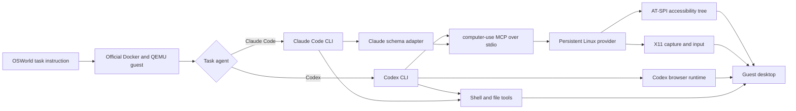

# Hybrid Computer Use

Hybrid Computer Use lets a coding agent operate a Linux desktop through the
Model Context Protocol (MCP), and runs Codex or Claude Code with it on
OSWorld and OSWorld-V2 tasks.

The `computer-use` MCP server exposes exactly two tools:

- `AX`: app-scoped accessibility observation, lookup, assertion and action
  through AT-SPI.
- `GUI`: full-desktop screenshots and absolute-pixel mouse and keyboard input.

During an evaluation the agent also keeps its shell, file editing and, for
Codex, its browser runtime over the Chrome DevTools Protocol (CDP). The
combination of these channels is what "hybrid" refers to.

## Architecture



The Go process owns the MCP protocol, tool schemas, batching, element
references, evidence and state caches. It embeds and starts one persistent
Python provider, which owns AT-SPI discovery, X11 window identity,
screenshots and synthesized input. GUI coordinates are always pixels of the
full-desktop image the tool returned. See [Architecture](docs/ARCHITECTURE.md).

## Repository layout

| Path | Contents |
| --- | --- |
| `computer-use/` | Go MCP server and its embedded Python AT-SPI/X11 provider |
| `hcu/osworld/` | OSWorld runner: one QEMU guest, agent and MCP process per task, the official evaluator and an optional interactive Judge |
| `hcu/gateway/` | Task-scoped model gateways that route and meter the agents' model requests |
| `osworld-overlay/` | Patches installed into a pinned OSWorld-V2 checkout |
| `skills/` | Agent instructions: hybrid, AX-only and GUI-only skills and shared base instructions |
| `guest-images/` | Scripts that add workstation dependencies to the official guest images |
| `docker/`, `scripts/` | Release build, desktop smoke image, installers and smoke tests |
| `configs/` | Agent release lock file, environment template and example batch configs |

## Quick start: the MCP server

Build the release binary in Docker and check its public surface:

```bash
make build    # writes artifacts/computer-use
make smoke    # starts the stdio server and requires exactly AX and GUI
```

`make build-local` builds with a local Go 1.22+ toolchain instead.

The server must run inside the signed-in desktop session, with Python 3,
PyGObject, the AT-SPI, GTK and GdkPixbuf typelibs, `xdotool`, `wmctrl` and
`x11-utils` installed:

```bash
artifacts/computer-use doctor
artifacts/computer-use mcp
```

[Computer Use MCP](docs/MCP.md) covers client configuration for Codex and
Claude Code, the public contract and troubleshooting.

## Quick start: OSWorld

OSWorld runs need Linux x86-64 with KVM, Docker, Python 3.10+, the
`happysixd/osworld-docker` image, an OSWorld guest qcow2 image and a model
gateway reachable from the Docker bridge network.

```bash
git clone https://github.com/xlang-ai/OSWorld-V2 external/OSWorld-V2
git -C external/OSWorld-V2 checkout d578d2d4e0dc82b43e270fdaa7fa89d9708cd154
python3 -m venv external/OSWorld-V2/.venv
external/OSWorld-V2/.venv/bin/pip install -e external/OSWorld-V2
python3 scripts/install-osworld-v2.py external/OSWorld-V2

make agents   # downloads the pinned Codex and Claude Code releases
make build
cp configs/env.example .env   # then fill in the paths
```

Both OSWorld and OSWorld-V2 tasks run through the same runner:

```bash
external/OSWorld-V2/.venv/bin/python -m hcu.osworld.run_task \
  --benchmark-version v2 --task-id 001 --agent codex ...
```

[Running OSWorld](docs/OSWORLD.md) walks through guest images, model
gateways, setup canaries, single tasks, batches and result files.

## Documentation

- [Architecture](docs/ARCHITECTURE.md): process model, AX and GUI state, evidence.
- [Computer Use MCP](docs/MCP.md): build, run, client setup, contract, troubleshooting.
- [Running OSWorld](docs/OSWORLD.md): the evaluation runbook.
- [Agent profiles](docs/AGENT_PROFILES.md): how Codex and Claude Code are configured.
- [AX, GUI and CDP](docs/AX_AND_CDP.md): desktop session and browser channels.
- [Skills](docs/SKILLS.md): the instructions the evaluated agent receives.
- [Guest dependencies](docs/GUEST_DEPENDENCIES.md): building dependency images.
- [Isolation](docs/ISOLATION.md): what an evaluated agent may and may not see.
- [Contributing](CONTRIBUTING.md) and [Changelog](CHANGELOG.md).

## Versioning

The release version lives in `VERSION` and is currently 1.0.0. The build
injects it into the binary (`computer-use --version` and the MCP
`serverInfo.version`) and into the Python package metadata.

## License

Original code is released under the [MIT license](LICENSE). Files modified
from OSWorld-V2 remain under the Apache License 2.0; see
[THIRD_PARTY_NOTICES.md](THIRD_PARTY_NOTICES.md).
