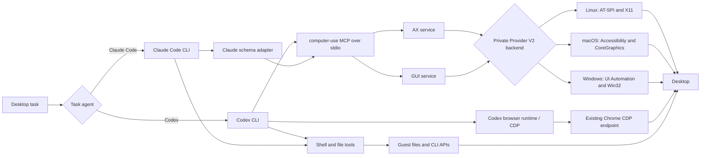

# Hybrid Computer Use OSS

Hybrid Computer Use OSS packages the Computer Use MCP and reproducible
integration code for running Codex or Claude Code. The standalone MCP now uses
one public contract on Linux, macOS, and Windows; the frozen OSWorld `v0.14`
benchmark artifact and QEMU integration remain Linux-specific.

The MCP exposes only two public tools:

- `AX`: semantic accessibility observation, lookup, assertion, and action.
- `GUI`: full-desktop screenshots and pixel-coordinate input.

The evaluated agent can also use Bash, file editing, application APIs, and the
Codex browser runtime. The product is the complete hybrid stack, not an
MCP-only agent. Formal V1 and V2 runs use the official Docker/QEMU backend;
the historical direct-container backend is retained only for fast diagnostics.

## Architecture



The Go process owns the MCP protocol, unchanged `AX`/`GUI` schemas, batching,
refs, evidence contracts, and state caches. It selects one persistent private
provider for the host OS. Linux uses AT-SPI/X11, macOS uses Accessibility,
System Events and CoreGraphics, and Windows uses UI Automation/Win32. GUI
coordinates are always pixels in the exact returned full-desktop image.

## Quick Start

For standalone MCP development, use Go 1.22+ and Python 3.10+ on Linux, macOS,
or Windows. Build the current host or all supported developer targets with:

```bash
make build-host
make build-all
```

The benchmark quick start still requires Linux, Docker, and an OSWorld V1 or V2
checkout. OSWorld V2 additionally needs KVM and its official guest image/assets.

```bash
git clone https://github.com/xlang-ai/OSWorld external/OSWorld
git clone https://github.com/xlang-ai/OSWorld-V2 external/OSWorld-V2
git -C external/OSWorld-V2 checkout d578d2d4e0dc82b43e270fdaa7fa89d9708cd154

python3 -m venv external/OSWorld-V2/.venv
external/OSWorld-V2/.venv/bin/pip install -U pip
external/OSWorld-V2/.venv/bin/pip install -e external/OSWorld-V2

make build
make verify
make smoke

make agents
python3 scripts/install-osworld-v2.py external/OSWorld-V2
```

`make agents` downloads the pinned, checksum-verified Linux x86-64 releases.
For local development only, an operator may instead copy explicitly selected
host binaries:

```bash
CODEX_BINARY=/path/to/codex \
CLAUDE_CODE_BINARY=/path/to/claude \
./scripts/prepare-agent-artifacts.sh
```

Then follow [OSWorld V1](docs/OSWORLD_V1.md) or
[OSWorld V2](docs/OSWORLD_V2.md).

For MCP build, startup, Codex/Claude configuration, public contracts and
troubleshooting, see [Computer Use MCP](docs/MCP.md).
For the native capability and validation matrix, see
[Platform Support](docs/PLATFORM_SUPPORT.md).

## Repository Map

- `computer-use/`: complete v0.14 Go and embedded Python implementation.
- `releases/v0.14/`: immutable release metadata.
- `skills/`: hybrid, AX-only, GUI-only, and common base instructions.
- `integrations/common/`: Claude MCP adapter and model gateway proxies.
- `integrations/osworld-v1/`: legacy direct-container diagnostic runner.
- `integrations/osworld-v2/`: unified V1/V2 QEMU runner and runtime overlay.
- `docker/`: reproducible MCP builder and V1 image layer.
- `docs/`: architecture, agent profiles, AX/CDP, runbooks, and review findings.

See [Docker And Startup](docs/DOCKER_AND_STARTUP.md) for the upstream Docker
comparison, backend selection, startup order, and operational checks.
See [Computer Use MCP](docs/MCP.md) for the standalone MCP operator guide.
See [Guest Workstation Dependencies](docs/GUEST_DEPENDENCIES.md) for the
separate V1 core and V2 full qcow2 profiles, exact image hashes, build commands,
and real-QEMU smoke evidence.

## Release Facts

`v0.14` was released on August 29, 2026. It keeps the v0.13 public schema and
raises the Linux GUI delivery bound from `1366x768` to `1920x1080`. Its public
surface is exactly `AX` and `GUI`. The release binary version string still
contains its promoted candidate ID:
`0.70.0-beta.70+osw-v013-gui-native-1080p`.

See [Release v0.14](docs/RELEASE_V014.md) and
[Refactoring Review](docs/REFACTORING.md). Current smoke and task evidence is
in [Validation](docs/VALIDATION.md). The exact skills and prompt
bindings are listed in [Skills](docs/SKILLS.md).

## Licensing

The Computer Use implementation is distributed under the MIT license inherited
from its upstream lineage. Files copied or adapted from OSWorld and OSWorld V2
remain under Apache-2.0. See [THIRD_PARTY_NOTICES.md](THIRD_PARTY_NOTICES.md).
