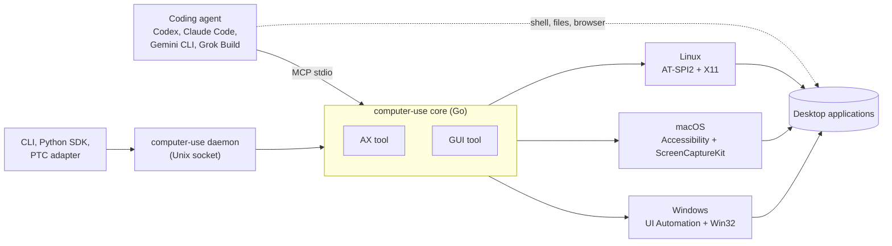

# Hybrid Computer Use

Let a coding agent operate a desktop through accessibility and pixels, from
one MCP server with two tools.

[](https://github.com/hqhq1025/hybrid-computer-use-oss/actions/workflows/ci.yml)

[](LICENSE)


## What it is

`computer-use` is a stdio MCP server that controls an already-running
desktop. It exposes exactly two tools. `AX` reads and operates application
windows through the operating system's accessibility API: it lists windows,
returns controls as short refs, and runs ordered actions with `wait` and
`select` steps. `GUI` takes full-desktop screenshots at the size the model
sees and sends absolute-pixel mouse and keyboard input. The agent keeps its
own shell, file tools and browser; "hybrid" means the agent picks the channel
that fits each step.



## Features

| Area | Behavior |
| --- | --- |
| AX modes | `apps` lists top-level windows as `wN`; `observe` returns a window tree with `rN` refs; `find` returns matching refs with paging; `act` runs up to 64 ordered steps. |
| AX refs | Refs name live elements, not selectors. Every action resolves its ref again and rejects stale or cross-window targets before input. |
| AX `act` | `click`, `type`, `keypress`, `set_value`, `select`, `scroll`, `activate`, `close` and `wait` steps. The first failed step stops the batch. A `wait` step sends no input and waits for a window, a `find` query, a ref's state or text. `select` reads the selection back. |
| AX results | An `effect:` line per targeted element, a `windows:` line for opened, closed and focused windows, and a compact diff by default. |
| Errors | Every result starts with one JSON line: `ok`, `code`, `path`, `message`, `hint` (a corrected call), `input_emitted`, `completed`. 12 public codes. |
| GUI screenshots | Every provider scales the desktop to fit 1366x768, the size the model sees. Coordinates are pixels of that image, mapped back to the native desktop per axis. |
| GUI input | Click, double click, move, drag, scroll, type, keypress and one-second wait, batched up to 64 actions with one final screenshot. |
| GUI stale protection | Before each coordinate action, the provider checks the window under that point against the screenshot. A change returns `gui_frame_stale` with nothing sent and a fresh screenshot. |
| Entry points | MCP over stdio; a per-desktop daemon shared by the CLI, the Python SDK (`hcu_sdk`) and the programmatic tool calling (PTC) adapter. All of them call the same core and return the same text or JSON records. |

## Platform support

| OS | Provider | Status | Checks |
| --- | --- | --- | --- |
| Linux | Embedded Python: AT-SPI2, X11, XTest | Primary; target of the OSWorld runner | Go tests and provider tests in CI; OSWorld guest runs |
| macOS 14+ | Swift app: AXUIElement, CoreGraphics, ScreenCaptureKit | Experimental | Swift unit tests, package build and MCP smoke test in CI (no desktop input) |
| Windows | C#/.NET 8: FlaUI UIA3, Win32 | Experimental | .NET policy tests, package build and MCP smoke test in CI (no desktop input) |

The build selects one backend per OS; see [Platform support](docs/PLATFORMS.md).

## Quick start

### 1. Build

```bash
make build-local   # Linux binary in artifacts/computer-use (Go 1.22+)
make smoke         # start the stdio server and require exactly AX and GUI
make build-macos   # macOS package in artifacts/macos/ (Swift 6.2+)
make build-windows # Windows package in artifacts/windows/ (.NET 8, PowerShell 7)
```

Run the server as the signed-in desktop user. `computer-use doctor` prints
the requirements for the current platform; [Computer Use MCP](docs/MCP.md#desktop-runtime)
lists the Linux packages.

### 2. Connect an MCP client

Codex (`~/.codex/config.toml`):

```toml
[mcp_servers.computer_use]
command = "/abs/path/to/artifacts/computer-use"
args = ["mcp"]
startup_timeout_sec = 60
tool_timeout_sec = 180
```

Claude Code (the adapter only reshapes the GUI schema it shows the model):

```bash
claude mcp add computer_use -- python3 \
  /abs/path/to/hcu/osworld/guest_files/claude_mcp_schema_adapter.py \
  /abs/path/to/artifacts/computer-use mcp
```

`python3 -m hcu.render_agent_config` writes full profiles for all four agents;
see [Computer Use MCP](docs/MCP.md#codex).

### 3. Drive it from a shell

```bash
computer-use apps                                    # list windows (w1, w2, ...)
computer-use find w1 --role button --name-has Save   # find refs (r12, ...)
computer-use click r12 --wait '{"window":"Save"}'    # act, then wait for a window
computer-use gui screenshot                          # screenshot written to a file
```

One daemon per desktop keeps refs valid between commands;
`computer-use help cli` lists every command and exit status.

### 4. Drive it from Python

```python
import hcu_sdk as hcu                     # PYTHONPATH=sdk/python
d = hcu.connect()                         # starts the daemon on first use
w = d.apps().windows[0].ref
save = d.find(w, role="button", name_contains="Save").matches[0]
d.click(save.ref, wait={"window": "Save"})
```

The SDK runs `computer-use` from `PATH` or `HCU_BIN`. Errors raise
`hcu.HcuError` subclasses such as `hcu.StaleRef`. See
[Code entry points](docs/CODE.md) for records, async use and PTC.

## Evaluation

`hcu.osworld` runs OSWorld and OSWorld-V2 tasks with any of the four agents.
Each task gets a fresh official Docker/QEMU guest, one MCP process and a
task-scoped model gateway (`hcu.gateway`) that holds the credentials and
enforces the model-call budget; the official evaluator scores the guest.
[Running OSWorld](docs/OSWORLD.md) is the runbook.

## Repository layout

| Path | Contents |
| --- | --- |
| `computer-use/cmd/computer-use/` | `main()` of the binary |
| `computer-use/internal/contract/` | Published tool schemas, server instructions, validation, error codes and limits |
| `computer-use/internal/core/` | Service, AX and GUI logic, refs, evidence rendering, provider port |
| `computer-use/internal/provider/` | Platform backends: Linux provider process, macOS and Windows sidecar transports |
| `computer-use/internal/transport/` | MCP stdio, daemon socket and CLI |
| `computer-use/native/{linux,macos,windows}/` | Native providers in Python, Swift and C# |
| `hcu/osworld/` | OSWorld runner, queue, setup canary and result summary |
| `hcu/gateway/` | Task-scoped OpenAI Responses, Anthropic and Gemini gateways |
| `sdk/python/` | `hcu_sdk`: Python SDK, code-executor adapter, PTC adapter, examples |
| `instructions/` | Model input: base policy and hybrid, AX-only and GUI-only guides |
| `osworld-overlay/` | Files installed into a pinned OSWorld-V2 checkout |
| `configs/` | Example OSWorld V1 and V2 queue configs |
| `scripts/`, `scripts/maint/` | OSWorld-V2 installer, MCP smoke test; maintenance checks |
| `analysis/tool_changes/` | Design and evaluation notes for individual tool changes |
| `tests/` | Python tests for the runner, gateways and configs |

## Documentation

| Document | Answers |
| --- | --- |
| [Architecture](docs/ARCHITECTURE.md) | How are processes and Go packages arranged, and which files change for a given interface change? |
| [Computer Use MCP](docs/MCP.md) | How do I build, run and configure the server, and what is the exact public contract? |
| [Code entry points](docs/CODE.md) | How do the daemon, CLI, Python SDK and PTC adapter work? |
| [Platform support](docs/PLATFORMS.md) | What does each OS need, and how do the native providers differ? |
| [Client compatibility](docs/CLIENT_COMPATIBILITY.md) | What must a new MCP client preserve, and which client limits do we know? |
| [Running OSWorld](docs/OSWORLD.md) | How do I run tasks and panels and read the results? |
| [Agent profiles](docs/AGENT_PROFILES.md) | How is each task agent configured and isolated? |
| [Instructions](docs/INSTRUCTIONS.md) | Which plain-text guidance reaches the model, and how is it selected? |
| [AX, GUI and CDP](docs/AX_AND_CDP.md) | How do the desktop channels and the browser channel start and divide work? |
| [Isolation](docs/ISOLATION.md) | What may an evaluated agent see? |

The documents were last verified against commit `a4006c5`.

## Contributing

Run `make test` (gofmt, `go vet`, Go tests, provider tests, pytest) before a
pull request; CI adds race, macOS, Windows, Swift and .NET checks. Tool
schemas, descriptions, error texts and `instructions/` are model input: read
[CONTRIBUTING.md](CONTRIBUTING.md) before changing them.

## License

[MIT](LICENSE) for original code. Files modified from OSWorld-V2 remain
under Apache 2.0; see [THIRD_PARTY_NOTICES.md](THIRD_PARTY_NOTICES.md).
