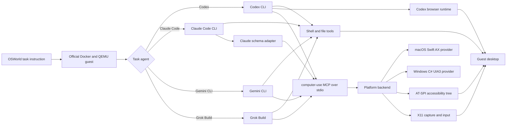

# Hybrid Computer Use

Hybrid Computer Use lets a coding agent operate a desktop through the
Model Context Protocol (MCP), and runs Codex, Claude Code, Gemini CLI or Grok
Build with it on OSWorld and OSWorld-V2 tasks.

The `computer-use` MCP server exposes exactly two tools:

- `AX`: app-scoped accessibility observation, lookup, assertion and action
  through the operating system's accessibility provider.
- `GUI`: full-desktop screenshots and absolute-pixel mouse and keyboard input.

During an evaluation the agent also keeps its shell, file editing and, for
Codex, its browser runtime over the Chrome DevTools Protocol (CDP). The
combination of these channels is what "hybrid" refers to.

## Architecture



The Go process owns the MCP protocol, tool schemas, batching, element
references, evidence and state caches. It selects one persistent native
provider: embedded Python AT-SPI/X11 on Linux, a Swift Accessibility app on
macOS, or a C# UIA3 executable on Windows. GUI coordinates are pixels of the
full-desktop image the tool returned. See [Architecture](docs/ARCHITECTURE.md).

## Repository layout

| Path | Contents |
| --- | --- |
| `computer-use/` | Go MCP server and Linux, macOS and Windows providers |
| `hcu/osworld/` | OSWorld runner: one QEMU guest, agent and MCP process per task, then the official evaluator |
| `hcu/gateway/` | Task-scoped model gateways that route and meter the agents' model requests |
| `osworld-overlay/` | Patches installed into a structurally compatible OSWorld-V2 checkout |
| `instructions/` | Plain-text base policy and hybrid, AX-only and GUI-only interaction guides |
| `docker/`, `scripts/` | Release build, installers and smoke tests |
| `configs/` | Agent release lock file, environment template and example batch configs |

## Quick start: the MCP server

Build the release binary in Docker and check its public surface:

```bash
make build    # writes artifacts/computer-use
make smoke    # starts the stdio server and requires exactly AX and GUI
```

`make build-local` builds with a local Go 1.22+ toolchain instead.

These two targets build the Linux binary. Native desktop packages use
`make build-macos` on macOS or the PowerShell build script on Windows.
See [Platform support](docs/PLATFORMS.md) for prerequisites, permissions,
and packaging. The native integration is experimental;
OSWorld runners remain Linux-based.

On Linux, the server must run inside the signed-in desktop session, with Python 3,
PyGObject, the AT-SPI, GTK and GdkPixbuf typelibs, `xdotool`, `wmctrl` and
`x11-utils` installed:

```bash
artifacts/computer-use doctor
artifacts/computer-use mcp
```

[Computer Use MCP](docs/MCP.md) covers client configuration for Codex and
Claude Code, the public contract and troubleshooting.

## Quick start: OSWorld

OSWorld runs need Linux x86-64 with KVM, Docker, Python 3.10+, the
`happysixd/osworld-docker` image, an OSWorld guest qcow2 image and a model
gateway reachable from the Docker bridge network.

```bash
git clone https://github.com/xlang-ai/OSWorld-V2 external/OSWorld-V2
git -C external/OSWorld-V2 checkout d578d2d4e0dc82b43e270fdaa7fa89d9708cd154
python3 -m venv external/OSWorld-V2/.venv
external/OSWorld-V2/.venv/bin/pip install -e external/OSWorld-V2
python3 scripts/install-osworld-v2.py external/OSWorld-V2

make agents   # downloads the pinned agent CLIs and the Node runtime
make build
cp configs/env.example .env   # then fill in the paths
```

OSWorld-V2 task classes and assets are gated on Hugging Face and have to be
downloaded into the checkout separately; [Running OSWorld](docs/OSWORLD.md)
lists the commands. After loading the edited environment file, preview the
current V2 example without starting a VM or spending model quota:

```bash
external/OSWorld-V2/.venv/bin/python -m hcu.osworld.run_batch \
  --config configs/osworld-v2-codex-queue.example.json --dry-run
```

[Running OSWorld](docs/OSWORLD.md) walks through guest images, model
gateways, setup canaries, single tasks, batches and result files.
[Experiment Configuration](docs/REPRODUCIBILITY.md) covers task selection,
instruction snapshots, queue execution and result summaries.

## Documentation

- [Architecture](docs/ARCHITECTURE.md): process model, AX and GUI state, evidence.
- [Computer Use MCP](docs/MCP.md): build, run, client setup, contract, troubleshooting.
- [Platform support](docs/PLATFORMS.md): native packages and permissions.
- [Running OSWorld](docs/OSWORLD.md): the evaluation runbook.
- [Experiment Configuration](docs/REPRODUCIBILITY.md): prepare and execute a task queue.
- [Agent profiles](docs/AGENT_PROFILES.md): how the four task agents are configured.
- [AX, GUI and CDP](docs/AX_AND_CDP.md): desktop session and browser channels.
- [Instructions](docs/INSTRUCTIONS.md): base policy, operating profiles and injection routes.
- [Isolation](docs/ISOLATION.md): what an evaluated agent may and may not see.

## Versioning

The release version lives in `VERSION`. The build
injects it into the binary (`computer-use --version` and the MCP
`serverInfo.version`) and into the Python package metadata.

## License

Original code is released under the [MIT license](LICENSE). Files modified
from OSWorld-V2 remain under the Apache License 2.0; see
[THIRD_PARTY_NOTICES.md](THIRD_PARTY_NOTICES.md).
