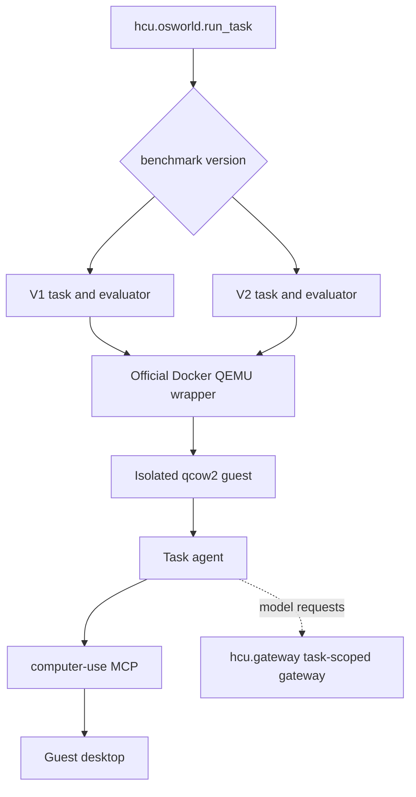
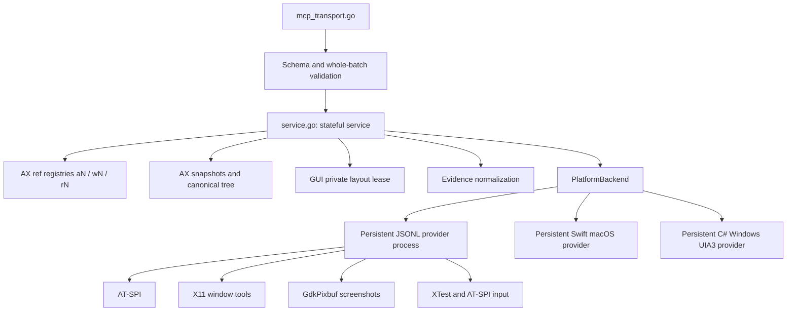

# Architecture

## Control plane

The OSWorld runner creates one isolated desktop per task, installs one task
agent and lets that agent start one `computer-use mcp` child over stdio. No
MCP state is shared across tasks.

OSWorld V1 and OSWorld-V2 runs share the official Docker/QEMU backend. The
benchmark version selects the task and evaluator generation, not the
virtualization.



Every task agent receives the original OSWorld instruction plus a minimal
runner contract for `TASK_COMPLETE`, `TASK_INFEASIBLE` and `ASK_USER`. The four
supported agents (Codex, Claude Code, Gemini CLI and Grok Build) also receive
the same base safety and outcome policy and selected interaction guide as
plain text through their own context routes. These files are always injected,
not discovered or activated as skills; omitting the profile keeps the base.
[Agent profiles](AGENT_PROFILES.md) lists the routes, and
[Instructions](INSTRUCTIONS.md) defines the separation from runner markers.

## MCP process



The main boundaries:

1. `tool_contract.go` publishes the server instructions and the strict,
   mode-specific JSON schemas; `tool_arguments.go` parses arguments.
2. `service.go` routes calls, owns session state and captures error context.
3. `ax_*.go` implements the canonical AX state, compact working projections,
   references, action guards, postconditions and evidence.
4. `gui_service.go` validates GUI batches and binds coordinates to the last
   screenshot.
5. `runtime_backend*.go` and `provider_*.go` implement the private,
   versioned provider protocol; platform transports run the provider process.
6. `native/linux/provider/` implements AT-SPI, X11, screenshots and input in
   Python. The binary embeds it and writes it to disk when it starts the
   provider process.
7. `native/macos/` and `native/windows/` implement native accessibility,
   screenshot and input mechanisms. Their app/executable is packaged beside
   the Go binary. A native worker is never shared between MCP processes.

macOS also implements the optional private ordered-keyboard operation. The
Go service still validates the whole public batch, binds one logical window,
and consumes per-action continuity and emission evidence. Other providers use
the existing per-action path. Provider argument rejection is distinct from a
transport failure and does not imply input or restart a healthy worker.

## AX state model

The server owns an identity graph:

```text
application aN -> logical top-level window wN -> element rN
```

References are short-lived capabilities, not selectors. Every mutation
resolves its reference against live canonical state. A reference becomes stale
when its exact target disappears or is replaced, and batches that would act
across windows fail before input.

The canonical AX tree stays complete. The model sees a compact working
projection that drops empty leaves and collapses neutral containers, while
`find`, selectors, references and actions keep querying canonical records.

## GUI state model

GUI is full-desktop and not tied to an application. A screenshot establishes
a private layout lease. Before each coordinate action the provider compares
the current desktop layout with the lease; if it changed, the action is
rejected before any input and a fresh screenshot is returned.

The provider returns the standard OSWorld desktop at its native 1920x1080.
Larger desktops are scaled to fit 1920x1080, and coordinates are mapped back
to the native desktop privately.

## Identity And Distribution

Runtime fingerprints remain private implementation details. Providers use
them to distinguish window instances, detect layout changes and preserve exact
element identity when displayed names are truncated. Semantic snapshot
fingerprints support state comparison. These mechanisms are unrelated to
release selection.

Release and run selection uses explicit versions and functional checks rather
than project-enforced content-digest gates. Third-party downloads retain their
recorded SHA256 checks to reject corrupted or substituted archives before
installation. Provider diagnostics include bounded text, original byte counts
and truncation metadata.

## Evidence model

An accepted call is not task completion. Responses distinguish:

- validation failures before input;
- input that was not emitted;
- input that was or may have been emitted;
- semantic postcondition evidence;
- visual evidence from screenshots;
- stale state that requires a new observation.

AX cannot prove pixels, durable file contents, network state or evaluator
acceptance, and GUI cannot prove semantic identity or persistence. The agent
has to pick the evidence source that matches the requested result.
