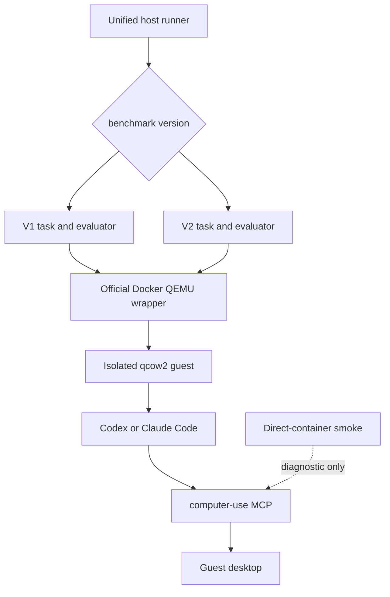
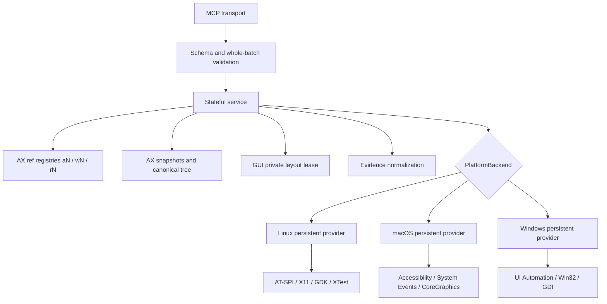

# Architecture

## Control Plane

The task harness creates one isolated desktop per task, installs one task-agent
binary, and starts one dedicated `computer-use mcp` child over stdio. No MCP
state is shared across tasks.

Formal OSWorld V1 and V2 runs share the official Docker/QEMU backend. The
benchmark version selects the task/evaluator generation; it does not select the
virtualization architecture. The direct-container backend is retained only for
fast Linux MCP regression tests.



Codex and Claude Code receive the original OSWorld instruction plus a minimal
completion contract. Codex loads the benchmark skill as `AGENTS.md`. Claude
Code receives the same skill appended to a replacement system prompt, because
leaving it as `CLAUDE.md` would allow duplicate or ambient configuration.

## MCP Process



The main boundaries are:

1. `tool_contract.go` publishes the strict mode-specific JSON schemas.
2. `main.go` routes calls and owns session state.
3. `ax_*` implements canonical AX state, compact working projections, refs,
   action guards, postconditions, and evidence.
4. `gui_service.go` implements batch validation and screenshot/layout binding.
5. `runtime_backend*.go` and `provider_wire_v2.go` implement the private,
   platform-neutral provider protocol.
6. `native/linux/provider_v1/`, `native/macos/provider_v1/`, and
   `native/windows/provider_v1/` implement the OS execution layers. Platform
   names and native handles never enter the public MCP schema.

The public contract is intentionally invariant across operating systems. A
model trained to use `AX` and `GUI` does not choose an OS-specific tool. The Go
service selects the backend at build time and normalizes native application,
window, element, screenshot, mutation, and action-evidence facts through
Provider V2.

## AX State Model

The server owns an identity graph:

```text
application aN -> logical top-level window wN -> element rN
```

Refs are short-lived capabilities, not selectors. Every mutation re-resolves
the ref against live canonical state. A ref becomes stale when its exact target
disappears or is replaced. Cross-window action batches fail before input.

The canonical AX tree remains complete. The model sees a compact working
projection that can remove empty leaves and collapse neutral containers.
`find`, selectors, refs, and actions still query canonical records.

## GUI State Model

GUI is full-desktop and app-free. A screenshot establishes a private layout
lease. Before each coordinate action the provider compares the current desktop
layout with the lease. If the layout changed, it rejects the stale coordinate,
emits no stale click, and returns a fresh screenshot.

The Linux provider returns native `1920x1080` for the standard OSWorld desktop.
Larger desktops are aspect-ratio bounded to `1920x1080`, with private coordinate
mapping back to the native virtual desktop.

## Evidence Model

An accepted API call is not task completion. Responses distinguish:

- validation failure before input;
- input not emitted;
- input emitted or possibly emitted;
- semantic postcondition evidence;
- visual screenshot evidence;
- stale state requiring a new observation.

AX cannot prove pixels, durable file contents, network state, or evaluator
acceptance. GUI cannot prove semantic identity or persistence. The agent must
use the evidence source appropriate to the requested result.
