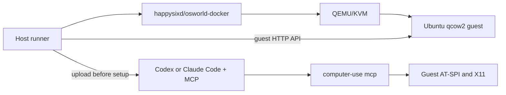
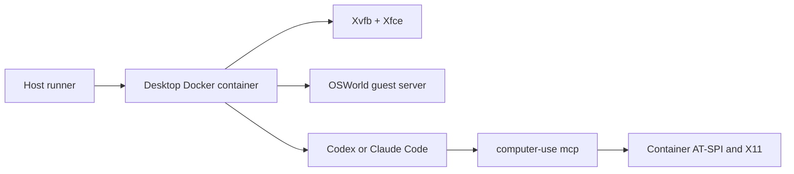

# Docker And Startup

## Two Independent Axes

OSWorld task generation and desktop runtime are separate choices:

```text
benchmark_version = v1 | v2
runtime_backend   = official-qemu | direct-container
```

The supported matrix is:

| Benchmark | Backend | Status | Intended use |
|---|---|---|---|
| V1 | official QEMU | primary | formal or comparable V1 evaluation |
| V2 | official QEMU | primary | formal V2 evaluation |
| V1 | direct container | diagnostic | fast MCP and harness regression |
| V2 | direct container | unsupported | do not report as V2 |

Changing the backend is not behavior-neutral. The task and evaluator may stay
the same, but kernel, application image, browser profile, D-Bus/AT-SPI timing,
filesystem persistence, networking, and performance all change. Re-run a
paired task subset before comparing scores.

## Official QEMU Backend



The outer Docker image is a QEMU launcher. The desktop is not running in that
container's root filesystem; it runs in the mounted qcow2 guest. The only
expected host bind mount is the guest image at `/System.qcow2`, read-only.
Writable task state lives in the runtime storage layer created for that VM.
Running the Docker image without a boot disk exits with
`No boot disk specified`; pulling the image does not download the OSWorld
desktop guest.

Both benchmark generations use
`integrations/osworld-v2/hybrid/run_hybrid.py`:

```bash
# V1 task suite
external/OSWorld-V2/.venv/bin/python integrations/osworld-v2/hybrid/run_hybrid.py \
  --benchmark-version v1 \
  --task-id 01b269ae-2111-4a07-81fd-3fcd711993b0 \
  --task-domain libreoffice_calc \
  --guest-image "$OSWORLD_V1_GUEST_IMAGE" \
  --expected-guest-image-sha256 "$OSWORLD_V1_GUEST_IMAGE_SHA256" \
  --tool-version v0.14 \
  --release-manifest releases/v0.14/release.json

# V2 task suite
external/OSWorld-V2/.venv/bin/python integrations/osworld-v2/hybrid/run_hybrid.py \
  --benchmark-version v2 \
  --task-id 099 \
  --guest-image "$OSWORLD_V2_GUEST_IMAGE" \
  --expected-guest-image-sha256 "$OSWORLD_V2_GUEST_IMAGE_SHA256" \
  --tool-version v0.14 \
  --release-manifest releases/v0.14/release.json
```

Use the guest image belonging to the selected benchmark release. Running V1
tasks on a V2 guest can be useful compatibility evidence, but is not an exact
historical V1 comparison.

Use the pinned OSWorld V2 virtual environment for the unified runner. A plain
system Python may not contain OSWorld dependencies such as `gymnasium`.

The QEMU runner performs these steps:

1. validate task, guest image, release, MCP, skill, and prompt bindings;
2. start one official outer runtime and one KVM guest;
3. clear ambient agent state in the guest;
4. upload the selected agent, MCP, configuration, prompt, and skill;
5. run task setup;
6. probe gateway connectivity, executable versions, and public MCP tools;
7. run the task agent, official evaluator, and optional interactive Judge;
8. preserve results and remove or stop the task container.

`client_password` is inherited from the upstream OSWorld guest contract. The
official local V1 image uses `user/password`; V2 uses
`user/osworld-public-evaluation`. Upstream setup commands use it for sudo, and
the overlay additionally uses it for root-volume expansion, timezone
alignment, stale-agent-state cleanup and isolated runtime-directory creation.
It is not introduced by the workstation dependency image.

Start at concurrency `1`. Increase only after measuring RAM, qcow2 copy and
expansion latency, Docker daemon pressure, and gateway capacity. Each active
guest commonly reserves several GiB of RAM and creates substantial disk I/O.

## Direct-Container Diagnostic Backend



This backend removes QEMU. It is faster and denser, but it shares the host
kernel and uses a custom desktop image. Keep it for contract tests and fast
development; do not label its result as official-QEMU benchmark evidence.

The desktop entrypoint starts components in this order:

```text
Xvfb
-> Xauthority cookie
-> session D-Bus
-> AT-SPI bus and registry
-> toolkit accessibility
-> xfwm4 / xfsettingsd / xfdesktop / panel
-> OSWorld guest server :5000
-> x11vnc :5900 and noVNC :6080
-> AT-SPI self-check
```

Chrome is intentionally not prestarted. Task setup owns Chrome and its CDP
forwarding, preventing profile and port conflicts.

Run the isolated smoke:

```bash
make smoke-v1-direct

python3 scripts/smoke-v1-direct.py \
  --image hybrid-computer-use:v0.14-source
```

The smoke verifies guest-server readiness, native `1920x1080` capture, binary
version, public tools, AX application observation, and GUI screenshot output.

## What Changed From Upstream

### V1 Historical Direct Container

Upstream V1's Docker provider starts `happysixd/osworld-docker`, mounts a qcow2
at `/System.qcow2`, exposes four host ports, and starts QEMU. The historical
hybrid provider instead:

- starts the desktop directly in `osw-hybrid:v0.14`;
- uses the dedicated `osw-net` bridge and direct container IP;
- uses fixed internal ports `5000`, `9222`, `6080`, and `8080`;
- sets `/dev/shm` to 2 GiB;
- resolves `host.docker.internal` to the selected bridge gateway;
- checks forwarding rules and uses an internal DNS server;
- removes VM download, registry, snapshot, and qcow2 management.

The direct desktop image added:

- GTK2 GAIL packages required for GIMP accessibility;
- OSWorld guest server and Python/PyAutoGUI dependencies;
- X11, window-management, screenshot, VNC, and CDP forwarding utilities;
- a deterministic Xvfb/D-Bus/AT-SPI/Xfce startup sequence;
- the promoted `computer-use` binary and agent CLIs.

### V2 Official QEMU Overlay

The V2 path retains the official outer image and qcow2/QEMU boundary. Its host
overlay adds:

- strict guest-image and release binding;
- isolated task caches and one VM per task;
- bounded startup and setup retries with preserved attempt evidence;
- root-disk capacity checks and controlled expansion;
- guest root writability and runtime probes;
- guest artifact upload before task setup;
- stale agent-context removal;
- task-scoped model-gateway routing;
- bounded CDP reconnect to the existing Chrome instance;
- stricter command, Chrome GUID, package-manager, and persistence diagnostics;
- optional host-pressure gates and interactive outcome Judge.

## Image Builds

Portable source-equivalent V1 diagnostic image:

```bash
make image-v1
```

Defaults:

```text
OSWORLD_BASE_IMAGE=osw-hybrid:v0.14
DOCKER_BUILD_NETWORK=host
```

The explicit host build network is required on hosts whose Docker daemon
references a missing default `docker0` bridge. Override it where a normal
builder network is known to work:

```bash
DOCKER_BUILD_NETWORK=default \
OSWORLD_BASE_IMAGE=<desktop-base> \
make image-v1
```

`docker/Dockerfile.release-v0.14` preserves the historical release layering
contract exactly, but requires the unpublished/local `osw-hybrid:v0.13` base.
`docker/Dockerfile.osworld-v1` is the runnable source-equivalent build and may
therefore have a different image ID even when the MCP binary hash is identical.

## Operational Checks

Before QEMU runs:

```bash
test -c /dev/kvm
docker image inspect happysixd/osworld-docker
qemu-img info "$OSWORLD_V2_GUEST_IMAGE"
df -h "$(dirname "$OSWORLD_V2_GUEST_IMAGE")"
free -h
```

Before direct-container diagnostics:

```bash
docker network inspect osw-net
docker image inspect osw-hybrid:v0.14
```

Never mix results from different guest images, MCP hashes, skills, prompts,
agent versions, model routes, or backend types in one reported round.
