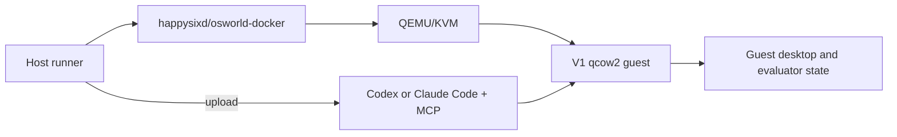

# OSWorld V1

Formal V1 runs use the official Docker/QEMU backend. The legacy
direct-container provider remains available only for fast diagnostic runs.



## Install

```bash
git clone https://github.com/xlang-ai/OSWorld-V2 external/OSWorld-V2
git -C external/OSWorld-V2 checkout d578d2d4e0dc82b43e270fdaa7fa89d9708cd154
python3 -m venv external/OSWorld-V2/.venv
external/OSWorld-V2/.venv/bin/pip install -U pip
external/OSWorld-V2/.venv/bin/pip install -e external/OSWorld-V2
python3 scripts/install-osworld-v2.py external/OSWorld-V2
make agents
make build
```

Configure an exact V1 guest image:

```bash
scripts/fetch-osworld-v1-image.sh "${HOME}/.cache/osworld-v1"

export OSWORLD_V1_GUEST_IMAGE="${HOME}/.cache/osworld-v1/Ubuntu.qcow2"
export OSWORLD_V1_GUEST_IMAGE_SHA256=6bf667a852b3c307f61d9f09c42559351f45e0607e428b4997becf534cf4d313
export OSWORLD_V1_VOLUME_SIZE=50
export OSWORLD_V1_CLIENT_PASSWORD=password
export OSWORLD_FILE_BASE_URL=/absolute/path/to/local-osworld-assets
```

The script pins Hugging Face dataset revision
`a5d9c3eaae98eebf6e3a0beb84e7e47cf72ae133`. It verifies the official
`Ubuntu.qcow2.zip` SHA-256
`b795b6cd4c69b252c1b4f10150a347795555032501b60fd031751ed09b896712`,
the ZIP CRC, and the extracted qcow2 SHA-256 above.

`happysixd/osworld-docker` is the QEMU, networking, and noVNC runtime. It does
not contain the Ubuntu desktop disk. The provider mounts the separately
downloaded qcow2 read-only at `/System.qcow2` and creates a disposable writable
overlay for each task.

The pinned OSWorld V2 checkout also carries the 369 V1 task JSON files under
`evaluation_examples/examples/` tree. Use a V1 guest image for exact V1
environment comparisons. A V1 task on a V2 guest is compatibility evidence,
not an exact V1 baseline.

The official V1 Ubuntu credentials are `user/password`. Pass
`--client-password password`; the V2 default password is different.

For the validated official-derived dependency image, use:

```bash
export OSWORLD_V1_GUEST_IMAGE=/absolute/path/to/v1-core-64g.qcow2
export OSWORLD_V1_GUEST_IMAGE_SHA256=acb8297f6d5e94a2c57eac6db05cc9822939d2c6389ce52cec5eb93306139479
export OSWORLD_V1_VOLUME_SIZE=64
```

## Setup Canary

```bash
external/OSWorld-V2/.venv/bin/python \
  integrations/osworld-v2/hybrid/run_setup_canary.py \
  --benchmark-version v1 \
  --task-domain libreoffice_calc \
  --task-id 01b269ae-2111-4a07-81fd-3fcd711993b0 \
  --guest-image "$OSWORLD_V1_GUEST_IMAGE" \
  --expected-guest-image-sha256 "$OSWORLD_V1_GUEST_IMAGE_SHA256" \
  --volume-size "$OSWORLD_V1_VOLUME_SIZE" \
  --result-dir runs/v1-setup-canary \
  --client-password "$OSWORLD_V1_CLIENT_PASSWORD"
```

## Model Gateway

The unified QEMU runner sends Codex requests to:

```text
<gateway-base>/t/<run-affinity-id>/v1
```

Start an OpenAI Responses-compatible gateway on a host address reachable from
the Docker network. The included proxy can sit in front of an OpenAI-compatible
upstream:

```bash
python3 integrations/common/openai_proxy.py \
  --host 0.0.0.0 \
  --ports 8600 \
  --out runs/v1/tokens.jsonl
```

Configure the proxy's upstream credentials through the environment expected by
`openai_proxy.py`; do not put secrets in repository files.

## Single Task

```bash
external/OSWorld-V2/.venv/bin/python integrations/osworld-v2/hybrid/run_hybrid.py \
  --benchmark-version v1 \
  --task-id <uuid> \
  --task-domain libreoffice_calc \
  --guest-image "$OSWORLD_V1_GUEST_IMAGE" \
  --expected-guest-image-sha256 "$OSWORLD_V1_GUEST_IMAGE_SHA256" \
  --volume-size "$OSWORLD_V1_VOLUME_SIZE" \
  --tool-version v0.14 \
  --release-manifest "$PWD/releases/v0.14/release.json" \
  --expected-release-manifest-sha256 bb83e49ca8c23047e8fc5458d8afb5f2859c9f52f3a6d0988facaf07fdf2e4c0 \
  --skill-file "$PWD/skills/hybrid/SKILL.md" \
  --expected-skill-sha256 61777e8101103cba07be3eacf26fc745a6c5bc94cbd1707ca194050f1f993d16 \
  --base-instructions-file "$PWD/skills/base/CODEX_BASE_INSTRUCTIONS.md" \
  --expected-base-instructions-sha256 2db42251f92d78881226342d36eb7a269f58cc63442915e2fa224dcbe14346af \
  --agent codex \
  --model gpt-5.5 \
  --effort xhigh \
  --gateway-base "$HCU_OPENAI_GATEWAY" \
  --client-password "$OSWORLD_V1_CLIENT_PASSWORD" \
  --max-model-calls 200 \
  --judge-model gpt-5.4 \
  --result-dir "$HCU_RESULTS_DIR/osworld-v1/<unique-run-id>"
```

For Claude Code:

```bash
external/OSWorld-V2/.venv/bin/python integrations/osworld-v2/hybrid/run_hybrid.py \
  --benchmark-version v1 \
  --task-id <uuid> \
  --task-domain libreoffice_calc \
  --guest-image "$OSWORLD_V1_GUEST_IMAGE" \
  --expected-guest-image-sha256 "$OSWORLD_V1_GUEST_IMAGE_SHA256" \
  --volume-size "$OSWORLD_V1_VOLUME_SIZE" \
  --tool-version v0.14 \
  --release-manifest "$PWD/releases/v0.14/release.json" \
  --skill-file "$PWD/skills/hybrid/SKILL.md" \
  --base-instructions-file "$PWD/skills/base/CODEX_BASE_INSTRUCTIONS.md" \
  --agent claude-code \
  --model claude-opus-5 \
  --claude-code-binary "$PWD/artifacts/claude-code" \
  --claude-gateway-base "$HCU_ANTHROPIC_GATEWAY" \
  --gateway-base "$HCU_OPENAI_GATEWAY" \
  --client-password "$OSWORLD_V1_CLIENT_PASSWORD" \
  --max-model-calls 200 \
  --judge-model gpt-5.4 \
  --result-dir "$HCU_RESULTS_DIR/osworld-v1/<unique-run-id>"
```

## Batch

```bash
external/OSWorld-V2/.venv/bin/python integrations/osworld-v2/run_batch.py \
  --config configs/osworld-v1-queue.example.json \
  --concurrency 1
```

Use `--dry-run` first. Increase concurrency only after measuring QEMU startup,
RAM, disk I/O, and gateway capacity.

Use a unique output/trace root per run. One task must own one fresh container,
agent process, MCP process, and trace directory.

## Direct-Container Diagnostics

The legacy provider and runner are retained for fast development:

```bash
make image-v1
make smoke-v1-direct

python3 integrations/osworld-v1/run_single.py \
  --task libreoffice_calc/<task-id>.json \
  --image hybrid-computer-use:v0.14-source
```

These results are not official-QEMU V1 results. See
[Docker And Startup](DOCKER_AND_STARTUP.md).
