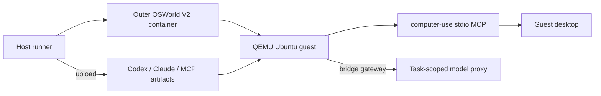

# OSWorld V2

V2 runs a stock outer Docker runtime containing a QEMU guest. The desktop,
agent, and MCP must all run inside the guest because the guest owns X11, D-Bus,
AT-SPI, and Chrome.



## Tested Baseline

- OSWorld V2 commit:
  `d578d2d4e0dc82b43e270fdaa7fa89d9708cd154`
- benchmark release: `osworld-v2-2026.08.08`
- current pinned Codex artifact: `0.151.0`
- current pinned Claude Code artifact: `2.1.251`
- Computer Use: `v0.14`

The agent pins were refreshed from the latest stable upstream releases on
August 29, 2026. They are run-configuration inputs and do not change the
Computer Use product version.

## Install

```bash
git clone https://github.com/xlang-ai/OSWorld-V2 external/OSWorld-V2
git -C external/OSWorld-V2 checkout d578d2d4e0dc82b43e270fdaa7fa89d9708cd154
python3 scripts/install-osworld-v2.py external/OSWorld-V2

python3 -m venv external/OSWorld-V2/.venv
external/OSWorld-V2/.venv/bin/pip install -U pip
external/OSWorld-V2/.venv/bin/pip install -e external/OSWorld-V2

make build
make agents
cp configs/env.example .env
```

Edit `.env` with absolute paths to the official V2 asset snapshot and guest
qcow2. Source it before running:

```bash
set -a
source .env
set +a
```

The overlay is intentionally pinned. On another OSWorld V2 commit, review the
diff and use `--force` only after confirming the changed setup/provider APIs.

## Single Task With Codex

```bash
external/OSWorld-V2/.venv/bin/python integrations/osworld-v2/hybrid/run_hybrid.py \
  --benchmark-version v2 \
  --task-id 099 \
  --agent codex \
  --model gpt-5.5 \
  --effort xhigh \
  --gateway-base "$HCU_OPENAI_GATEWAY" \
  --artifact-dir "$HCU_ARTIFACT_DIR" \
  --guest-image "$OSWORLD_V2_GUEST_IMAGE" \
  --expected-guest-image-sha256 "$OSWORLD_V2_GUEST_IMAGE_SHA256" \
  --volume-size "$OSWORLD_V2_VOLUME_SIZE" \
  --client-password "$OSWORLD_V2_CLIENT_PASSWORD" \
  --skill-file "$PWD/skills/hybrid/SKILL.md" \
  --expected-skill-sha256 61777e8101103cba07be3eacf26fc745a6c5bc94cbd1707ca194050f1f993d16 \
  --base-instructions-file "$PWD/skills/base/CODEX_BASE_INSTRUCTIONS.md" \
  --expected-base-instructions-sha256 2db42251f92d78881226342d36eb7a269f58cc63442915e2fa224dcbe14346af \
  --tool-version v0.14 \
  --release-manifest "$HCU_ARTIFACT_DIR/releases/v0.14/release.json" \
  --expected-release-manifest-sha256 bb83e49ca8c23047e8fc5458d8afb5f2859c9f52f3a6d0988facaf07fdf2e4c0 \
  --max-model-calls 200 \
  --timeout 0 \
  --judge-model gpt-5.4 \
  --result-dir "$HCU_RESULTS_DIR/osworld-v2/<unique-run-id>"
```

## Single Task With Claude Code

Start an Anthropic-compatible proxy reachable from the guest, then:

```bash
external/OSWorld-V2/.venv/bin/python integrations/osworld-v2/hybrid/run_hybrid.py \
  --benchmark-version v2 \
  --task-id 099 \
  --agent claude-code \
  --model claude-opus-5 \
  --effort xhigh \
  --claude-gateway-base "$HCU_ANTHROPIC_GATEWAY" \
  --gateway-base "$HCU_OPENAI_GATEWAY" \
  --artifact-dir "$HCU_ARTIFACT_DIR" \
  --guest-image "$OSWORLD_V2_GUEST_IMAGE" \
  --expected-guest-image-sha256 "$OSWORLD_V2_GUEST_IMAGE_SHA256" \
  --volume-size "$OSWORLD_V2_VOLUME_SIZE" \
  --client-password "$OSWORLD_V2_CLIENT_PASSWORD" \
  --skill-file "$PWD/skills/hybrid/SKILL.md" \
  --base-instructions-file "$PWD/skills/base/CODEX_BASE_INSTRUCTIONS.md" \
  --tool-version v0.14 \
  --release-manifest "$HCU_ARTIFACT_DIR/releases/v0.14/release.json" \
  --max-model-calls 200 \
  --timeout 0 \
  --judge-model gpt-5.4 \
  --result-dir "$HCU_RESULTS_DIR/osworld-v2/<unique-run-id>"
```

## Small Batch

Edit `configs/osworld-v2-queue.example.json`, then run:

```bash
external/OSWorld-V2/.venv/bin/python integrations/osworld-v2/run_batch.py \
  --config configs/osworld-v2-queue.example.json \
  --concurrency 2
```

Use `--dry-run` first to validate and print the generated task commands.

This public runner creates one `run_hybrid.py` process and one result directory
per task. Start with concurrency `1`; increase it only after validating host
RAM, disk I/O, Docker/QEMU capacity, and model-gateway limits.

`integrations/osworld-v2/hybrid/run_queue.py` is the stricter experiment
orchestrator. It also supports frozen OSWorld execution snapshots, immutable
benchmark bindings, host-pressure gates, retry recovery, and
hybrid-versus-original paired runs. Its queue file therefore requires
additional hashes and capacity fields and is not the default quick-start path.

## Runtime Flow

Before task setup, the runner:

1. validates the guest image, MCP, release manifest, skill, and prompt hashes;
2. removes baked `.codex`, `.claude`, `.claude.json`, `AGENTS.md`, and
   `CLAUDE.md`;
3. uploads the selected agent, MCP, config, prompt, and skill;
4. binds them to the guest desktop session;
5. probes versions, gateway health, and the exact MCP tool list;
6. starts the task only after setup completes.

The public OSS runner uses the official OSWorld evaluator. Internal
task-specific evaluator overrides are deliberately not included. The optional
interactive Judge can be enabled with `--judge-model`.

## CDP Patch

The installer adds `desktop_env/cdp.py` and the matching getter/setup overlay.
It connects to the existing browser with bounded retries and never starts a
replacement browser to hide CDP startup failures.
